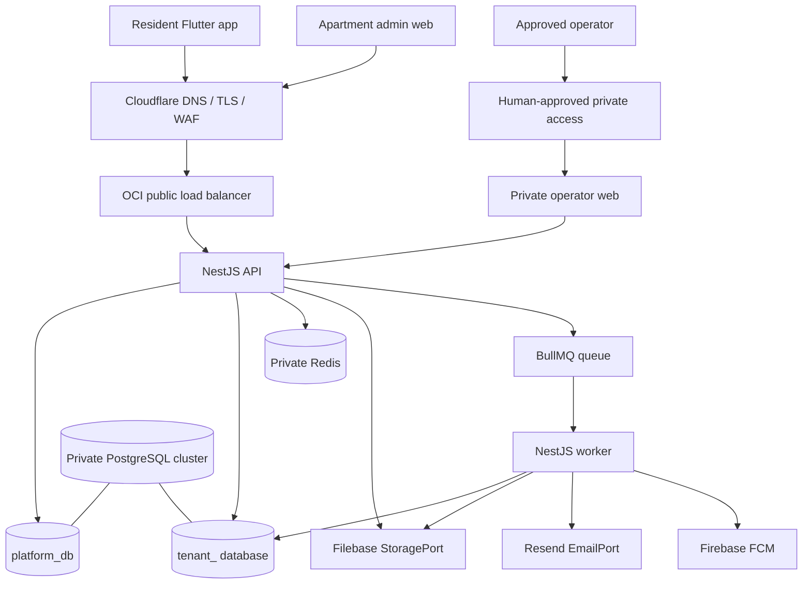

# Product and system architecture

## Product and actors

Nivasa provides apartment association operations through three authenticated
surfaces:

| Actor | Surface | Main responsibilities |
| --- | --- | --- |
| Resident | Flutter mobile app | Review dues, pay invoices, see receipts/history, read notices, manage profile and preferences |
| Apartment administrator / staff | Next.js admin web | Manage organization structure, residents, billing, collections, overdue accounts, reports, and team settings |
| Nivasa platform operator | Separate Next.js operator console | Onboard and manage customer organizations, provision tenant databases, manage plans and campaigns, monitor platform activity and audit |

The API is the authority for authentication, tenant selection, permissions,
feature entitlements, and all business operations. Client-side visibility is
for user experience only.

## Prototype feature map

### Resident experience

- Login and logout; production login uses email OTP, not the prototype's
  selectable demo roles or demo password.
- Tenant-aware home view with current maintenance due, due date, invoice
  breakdown, recent transactions, and community announcements.
- Payment review with itemized monthly maintenance, water, sinking fund,
  previous dues, fees, and total.
- Payment method selection for methods enabled by the tenant's configured
  payment provider; the initial prototype depicts UPI, cards, and net banking.
- Asynchronous payment lifecycle: created, pending, succeeded, failed,
  cancelled, refunded where supported, and reconciled. Never show a successful
  payment based only on a browser callback.
- Downloadable receipts, payment history with status filters, transaction
  references, and payment confirmation notification.
- Notices with unread state and mark-all-as-read behavior.
- Profile, apartment/unit details, notification preferences, saved-payment
  method view where supported, help/support, privacy/data information, and
  ad preferences.
- Sponsored recommendation cards on eligible home placements only. Clearly
  label sponsored content, respect tenant and resident ad preferences, cap
  frequency, and never display ads during bill review, checkout, payment
  processing, or receipt screens.

### Apartment admin experience

- Overview: billed, collected, outstanding, and overdue totals; collection
  trends; unit payment status; recent transactions; export and navigation to
  relevant work queues.
- Buildings and units: apartment setup is a three-stage flow: collect the
  apartment name, city, address, and billing start month; configure the first
  building's name, floor count, units per floor, unit prefix/number format, and
  optional standard maintenance rate per square foot; then create and confirm
  the apartment, building, and vacant units. Unit labels use
  `PREFIX-FLOORUNIT` (for example `A-0101`), and the API caps generation at
  20,000 units per request. Creation is atomic. It does not start billing or
  notify residents. Continue to support subsequent building/unit management,
  occupancy and unit metadata, rates, CSV import, validation errors, and
  resident association.
- Residents: invite by email to a selected building/unit with owner/tenant
  occupancy and optional phone details. Invitation links are single-use,
  expire after seven days, and require Email OTP verification of the invited
  address before creating a resident account and tenant membership. Email is
  the only enabled invitation channel; SMS/WhatsApp delivery remains disabled.
  Search/filter by building/occupancy, inspect unit assignment and payment
  status, and manage access.
- Billing: configure charge rules and due dates; preview a billing run; surface
  exceptions; publish invoices only after an explicit authorized confirmation;
  enqueue resident notifications.
- Collections: search/filter transactions, export CSV, record authorized
  offline payments with evidence/audit history, review discrepancies, and
  reconcile gateway settlements when a provider is configured.
- Overdue dues: aging buckets and follow-up status; select accounts and send
  bulk reminders through approved channels. The current product decision is
  that SMS and WhatsApp are login/verification channels only, so reminder
  delivery must not use those channels. Use email and in-app notices unless a
  later explicit product decision changes this.
- Reports: collection, settlement reconciliation, outstanding dues, and
  follow-up reports with tenant-scoped filters and exports.
- Settings: organization profile and communication, billing rules, team and
  role permissions, payment integration configuration, resident notification
  and ad preferences.

### Platform operator experience

- Platform overview with aggregate organization, resident, unit, transaction,
  revenue, and service-health metrics. Tenant aggregates must not expose
  resident-level data.
- Organization onboarding: customer identity, location, administrator invite,
  estimated unit count, plan assignment, provisioning status, and activation
  monitoring.
- Organization lifecycle and plan management: active, onboarding, review,
  suspended states; plan entitlements and limits; safe suspend/reactivate
  operations.
- Monetization: plans/subscriptions, service fees, advertising revenue, and
  explicit separation of platform revenue from customer maintenance funds.
- Ad campaign management: create/draft/publish, allowed home placement,
  audience/eligibility, campaign dates, analytics, resident-trust policy, and
  frequency caps. No sensitive payment targeting or checkout placements.
- Platform transactions and settlement monitoring; customer support work
  queue; immutable platform audit log; platform configuration, integrations,
  and access policies.
- Operator support access, if implemented, must be explicitly scoped,
  time-limited, approved, and audited. The prototype's aggregate operator
  screen is not permission to browse tenant records by default.

### Prototype-only presentation choices

The demo role switcher, hard-coded accounts, sample tenant/customer records,
static charts, false success states, and placeholder navigation are not
production requirements. Replace them with real state, APIs, empty/loading/
error states, and permission checks. Keep the feature surfaces and intended
workflows above; complete any displayed action as real behavior or render it
as unavailable with a clear reason until its dependency is configured.

## Recommended stack

Use the sample architecture's boundaries, adapted to Nivasa:

| Area | Initial choice |
| --- | --- |
| Monorepo | pnpm workspaces; confirm package layout during foundation phase |
| Resident app | Flutter; one tenant-aware application, no tenant database credentials |
| Admin web | Next.js App Router |
| Operator web | Separate Next.js application with private production ingress |
| API | NestJS modular monolith, versioned REST API with OpenAPI |
| Worker | Separate NestJS process using the same application layer |
| Domain and persistence | TypeScript domain/application packages; Prisma with PostgreSQL |
| Primary database | PostgreSQL; one `platform_db` plus one database per tenant |
| Queue/cache | Redis with BullMQ; idempotent jobs, bounded retries, failed-job inspection |
| Identity | Auth0 OIDC; email OTP primary; preferred Twilio messaging adapter for optional phone/WhatsApp login OTP, gated on integration validation |
| Transactional email | Resend, using environment-specific credentials |
| Push | Firebase Cloud Messaging through `NotificationPort` |
| Object storage/backups | Filebase S3-compatible API through `StoragePort` |
| Initial production | OCI, Cloudflare DNS/TLS/WAF, Terraform, GitHub Actions approvals |
| Future cloud | AWS provider adapters and Terraform only after an ADR; no domain rewrite |

The payment provider remains unchosen. Implement a typed `PaymentPort` and
provider-neutral payment intents, webhook verification, reconciliation state,
and idempotency. Do not ship a fake adapter in runtime environments or imply
that Razorpay is selected. Enabling live checkout is blocked until a provider,
merchant settlement model, credentials, webhook ownership, and test accounts
are approved.

## Application and package boundaries

```text
apps/
  api/                 NestJS HTTP composition root
  worker/              NestJS queue processors
  resident-mobile/     Flutter app
  admin-web/           Next.js tenant admin
  operator-web/        Next.js private platform console
packages/
  contracts/           OpenAPI schemas and generated/client DTOs
  domain/              aggregates, value objects, invariants; no I/O
  application/         use cases; depends on ports
  config/              typed non-secret configuration schemas
  shared/              errors, logging types, and provider-free utilities
infrastructure/
  ports/               database, identity, payment, queue, storage, email, etc.
  adapters/            PostgreSQL/Prisma, Auth0, OCI, Filebase, Resend, Firebase
  deployment/          container/runtime composition
terraform/
  modules/
  environments/
    oci-staging/
    oci-production/
    aws-production/    reserved until separately approved
docs/
  architecture/
  implementation-prompts/
```

`domain` depends on no other application package. `application` depends on
domain and ports. Provider SDKs belong only in infrastructure adapters and
composition roots. Web and mobile clients use APIs only; they never connect
directly to PostgreSQL or Redis.

## API surfaces and principal modules

All product APIs use `/v1` and OpenAPI as the contract.

- Public: `/v1/public/...`; only explicitly public tenant content, rate-limited.
- Tenant: `/v1/...` excluding public/platform routes; membership, tenant
  context, permissions, entitlements, and the tenant database are required.
- Platform: `/v1/platform/...`; platform operator identity plus platform role.
- Health: liveness and readiness endpoints without secrets or infrastructure
  locators.

Suggested NestJS modules: Identity/Auth, Platform Tenants, Provisioning,
Bootstrap/Organization Configuration, Properties, Buildings/Units, Residents,
Roles/Permissions, Billing, Invoices, Payments, Reconciliation, Notifications,
Notices, Reports/Exports, Ads/Campaigns, Support, Audit, Health.

Register public and platform routes before generic tenant routes. Never allow a
generic route to capture `/v1/platform/...` or `/v1/public/...`.

## Runtime shape



The operator web has no public DNS, Cloudflare route, or public load-balancer
listener. Private network reachability does not replace API authentication or
authorization. The exact human-approved private access mechanism remains a
deployment gate.
